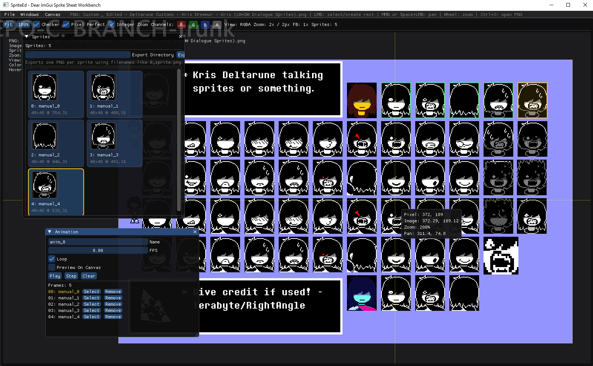
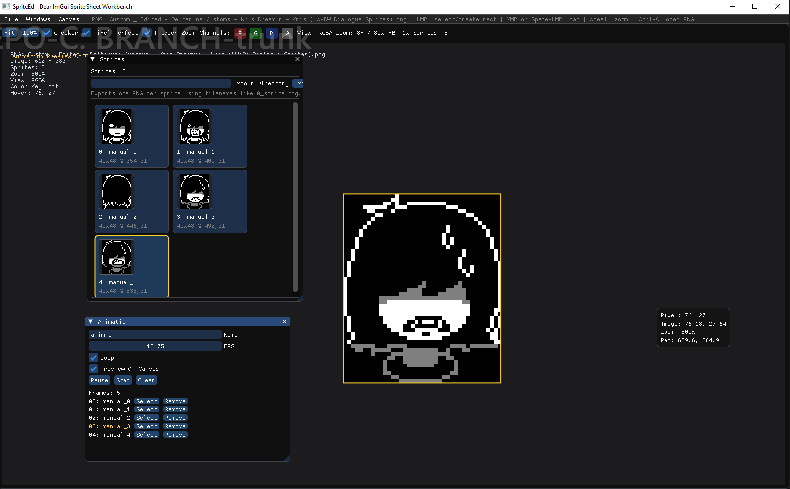
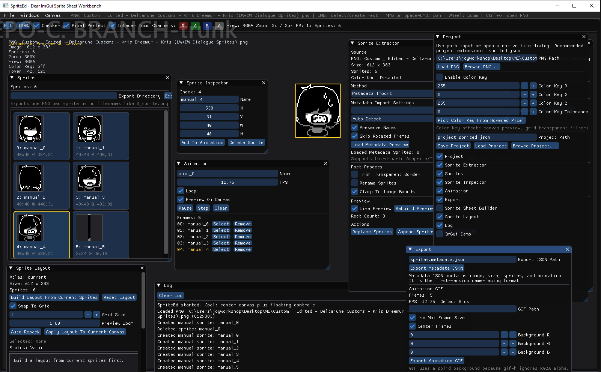

# SpriteEd

SpriteEd 是一个个人使用的 C++20 / Dear ImGui 精灵表编辑工作台。第一版方向不是保守复刻 TexturePacker，而是优先落地“中心画布 + 浮动控制台”的高效率工作流。





## 第一版已覆盖

- Dear ImGui 主窗口，启用 Docking，默认可启用 Viewports。
- GLFW + OpenGL 3.3 后端。
- 使用 stb_image 加载 PNG。
- 中心 Canvas 只渲染图片 / sprite sheet / 动画预览结果。
- 鼠标滚轮缩放，中键或 Space + 左键平移。
- Fit、100% 缩放、棋盘格背景、坐标 tooltip。
- 画布左键点击选择 sprite rect，空白区域拖拽手动框选 rect。
- Sprite Inspector 支持改名、调整 x/y/w/h、删除、加入动画。
- Grid Extractor 浮窗支持 cell width/height、spacing、margin、offset，并可实时预览、替换或追加 rect。
- Animation 浮窗支持 FPS、播放/暂停、循环、逐帧、中心画布动画预览。
- Project JSON 保存/加载，推荐扩展名 `.sprited.json`。
- Metadata JSON 导出。
- GIF 导出入口与多图 atlas 模块占位。

## 构建

```bash
cmake -S . -B build -DCMAKE_BUILD_TYPE=Release
cmake --build build --config Release
```

Windows + Visual Studio 多配置生成器可使用：

```bash
cmake -S . -B build
cmake --build build --config Release
```

如果暂时没有 GUI 第三方依赖，仍可只构建核心逻辑测试：

```bash
cmake -S . -B build-tests -DSPRITED_BUILD_APP=OFF
cmake --build build-tests --config Debug
ctest --test-dir build-tests -C Debug --output-on-failure
```

## 第三方依赖

当前 CMake 会优先使用本地 `external/` 目录中的源码；如果本地不存在，并且 `SPRITED_USE_FETCHCONTENT=ON`，才会用 FetchContent 自动获取：

- GLFW 3.4
- nlohmann_json v3.11.3
- Dear ImGui docking 分支 tag：v1.91.9b-docking
- stb

推荐离线目录结构：

```text
external/glfw/CMakeLists.txt
external/imgui/imgui.cpp
external/imgui/backends/imgui_impl_glfw.cpp
external/stb/stb_image.h
external/nlohmann_json/CMakeLists.txt
```

如果 GitHub 连接不稳定，可以手动下载这些依赖压缩包并解压到上面的目录，然后使用：

```bash
cmake -S . -B build -DSPRITED_USE_FETCHCONTENT=OFF
cmake --build build --config Release
```

如果本地依赖缺失且关闭 FetchContent，CMake 会直接报出缺失的 `external/...` 路径，方便补齐依赖。

## 使用方式

1. 启动 SpriteEd。
2. 在 `Project / 项目` 浮窗输入 PNG 文件路径，点击 `Load PNG`。
3. 在中心画布中：
   - 滚轮缩放。
   - 中键拖拽或 Space + 左键拖拽平移。
   - 左键点击已有矩形选择。
   - 在图片空白区域左键拖拽创建手动 sprite rect。
4. 使用 `Grid Extractor / 网格提取` 快速生成规则网格 rect。
5. 在 `Sprite Inspector / 精灵检查器` 改名、调整尺寸或加入动画。
6. 在 `Animation / 动画` 播放预览，并可勾选 `Preview On Canvas` 让中心画布显示当前动画帧。
7. 使用 `Save Project` 保存 `.sprited.json`。
8. 使用 `Export Metadata JSON` 导出游戏侧可读取的 metadata。

## 推荐下一步

- 接入 nativefiledialog-extended，替换路径输入框。
- 用 stb_image_write 或自写 RGBA buffer 输出 atlas PNG。
- 增加 ShelfPacker：多图按行打包，支持 padding / margin。
- 增加 trim transparent pixels，并记录 source size / offset。
- 接入 gif-h 或 msf_gif，实现最小 GIF 导出。
- 增加 Alpha Components 自动提取。
- 增加像素网格、吸附、参考线、重叠高亮、透明区域高亮。
